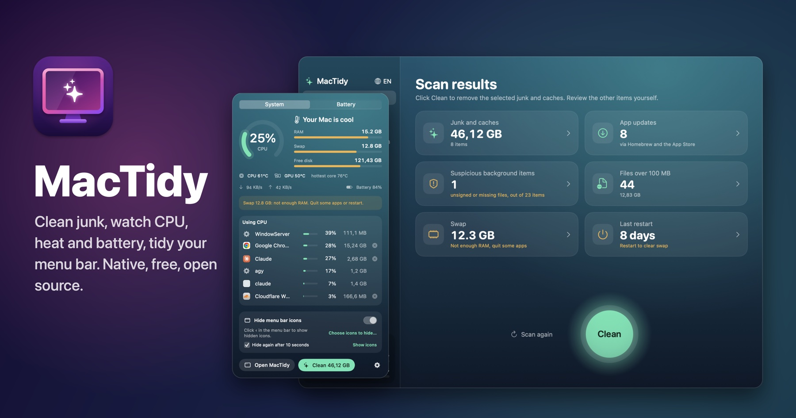
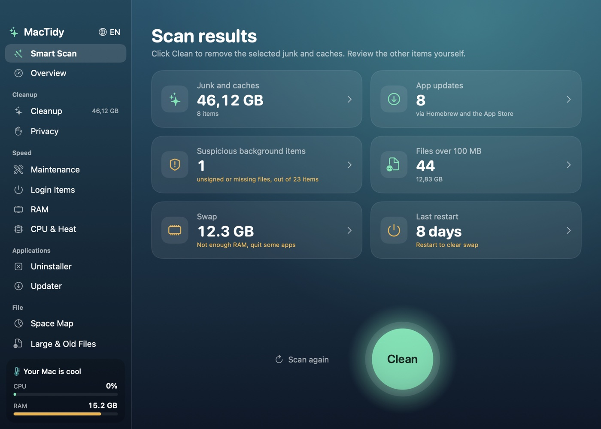
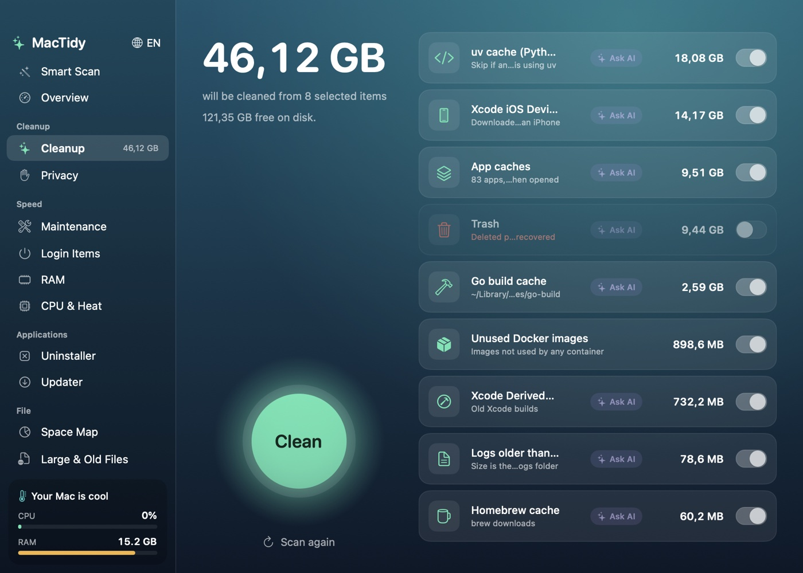
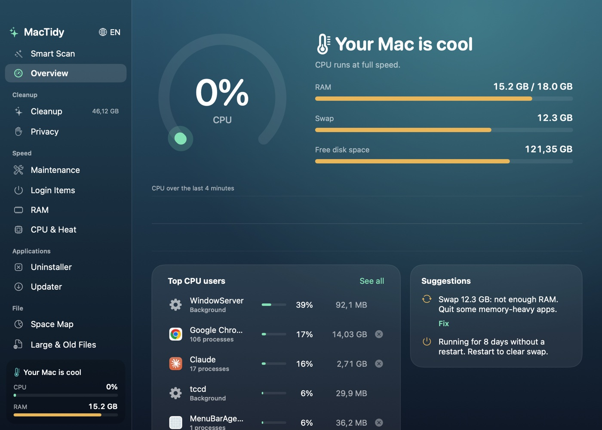
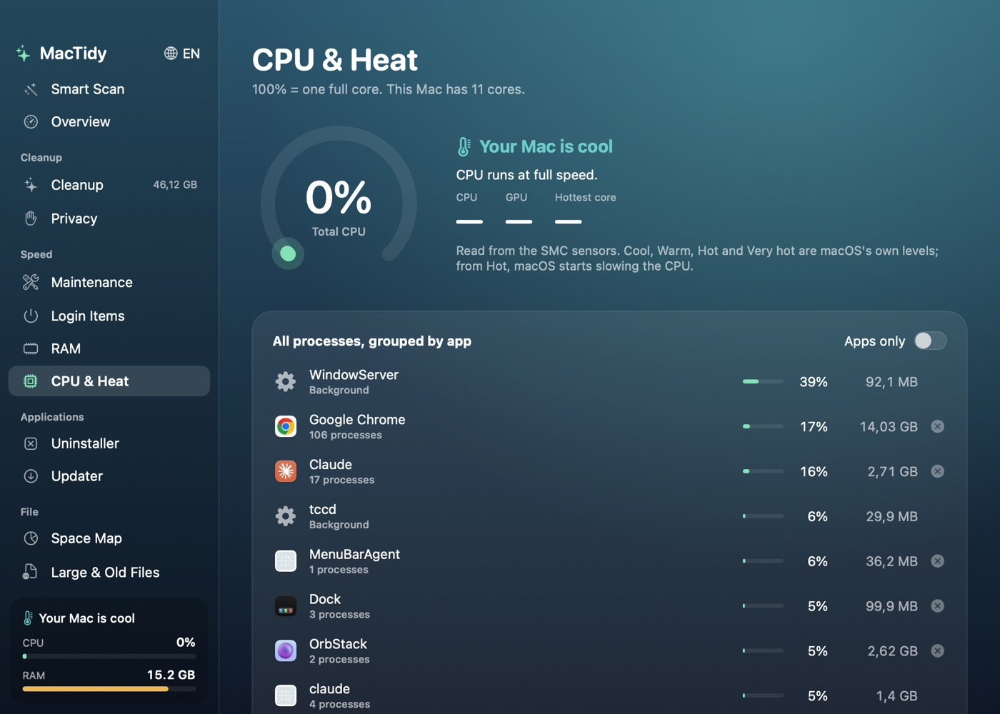
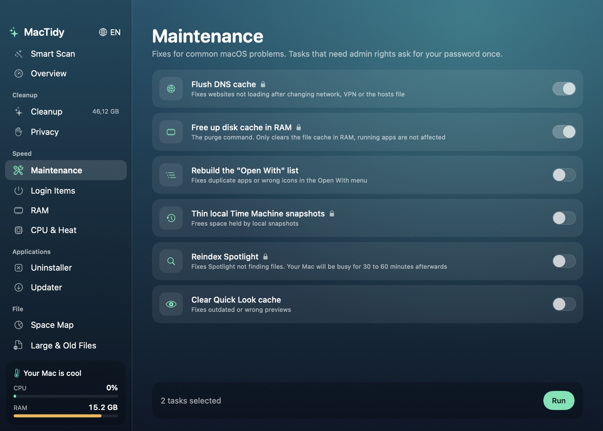
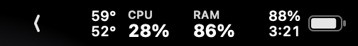
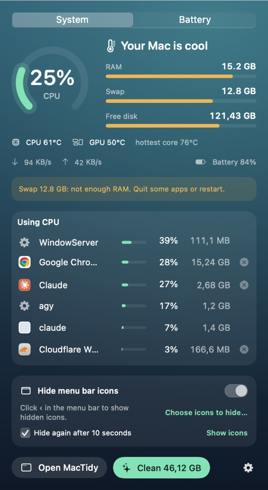
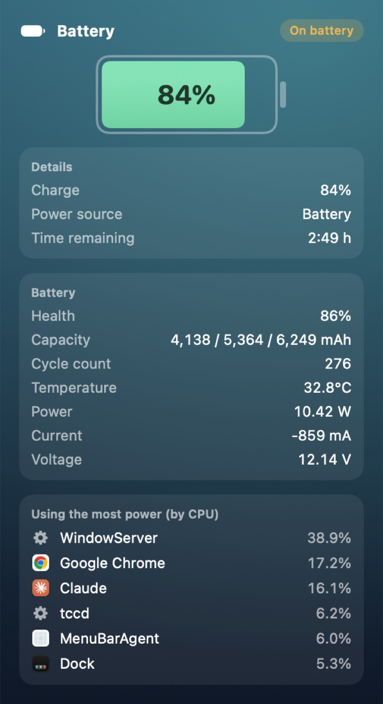
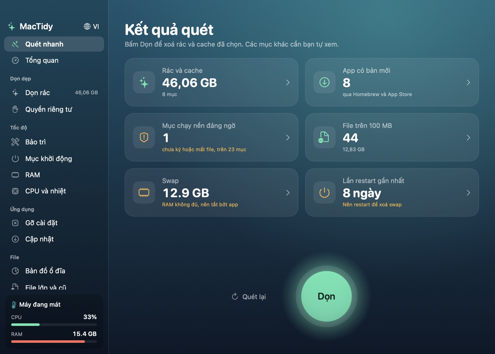

<p align="center">
  
</p>

<p align="center">
  <a href="https://github.com/huahuu1/MacTidy/releases/latest"></a>
  
  
  <a href="LICENSE"></a>
</p>

<p align="center">
  <b>English</b> · <a href="README.vi.md">Tiếng Việt</a>
</p>

MacTidy is a native macOS app that cleans junk, shows what is slowing your Mac down and keeps CPU, temperature and battery in your menu bar. It is written in SwiftUI, is about 4 MB, and runs at 1 to 2% CPU in the background.

## Contents

- [Install](#install)
- [Features](#features)
- [How to use](#how-to-use)
- [Ask AI before you delete](#ask-ai-before-you-delete)
- [Privacy and safety](#privacy-and-safety)
- [Build from source](#build-from-source)
- [FAQ](#faq)

## Install

### Homebrew (recommended)

```bash
brew install --cask huahuu1/tap/mactidy
```

To update later:

```bash
brew upgrade --cask mactidy
```

### DMG

1. Download `MacTidy-x.x.dmg` from [Releases](https://github.com/huahuu1/MacTidy/releases/latest).
2. Open it and drag **MacTidy** into **Applications**. It must be `/Applications`: on macOS 27, only apps there keep their menu bar icon visible while other icons are hidden.
3. The app is not notarized by Apple, so the first launch is blocked. Run this once, then open the app normally:

```bash
xattr -dr com.apple.quarantine /Applications/MacTidy.app
```

Or open **System Settings > Privacy & Security** and click **Open Anyway** next to MacTidy.

**Requirements:** macOS 14 Sonoma or later. Apple silicon and Intel. Hiding menu bar icons without a gap needs macOS 27.

## Features

| | |
|---|---|
| **Smart Scan** | One scan finds junk and caches, app updates, suspicious background items and large files. Nothing is deleted until you click Clean. |
| **Cleanup** | App caches, developer tool caches (Docker, Go, uv, npm, Homebrew, Xcode DerivedData, iOS DeviceSupport), old logs, installers in Downloads, Mail attachments, old iPhone backups. Files go to the Trash. |
| **Privacy** | Browsing history, cookies and other traces of Chromium browsers (Chrome, Edge, Brave, Arc, Cốc Cốc...), the macOS recent items list and Terminal history. Nothing is selected by default. |
| **Maintenance** | Flush DNS, free the disk cache in RAM, rebuild the "Open With" list, thin local Time Machine snapshots, reindex Spotlight, clear the Quick Look cache, run the macOS maintenance scripts. Asks for your admin password once. |
| **Login Items** | Apps that open at login and background launch agents and daemons, with code signature checks. Unsigned items and items whose executable is gone are listed first. |
| **RAM, CPU & Heat** | Which apps use the most memory and CPU, grouped by app. CPU, GPU and hottest core temperatures read from the SMC sensors. Quit or force quit from the list. |
| **Uninstaller** | Removes an app with its leftovers in `~/Library`, or resets an app by deleting only its data. |
| **Updater** | Apps from Homebrew and the App Store that have updates. Update one or all. |
| **Space Map, Large & Old Files, Duplicates** | See which folders use the space, find files over 100 MB or not opened in a year, and find duplicates by content (SHA-256). |
| **Menu bar stats** | CPU and GPU temperature, CPU %, RAM %, network speed and battery, drawn as crisp vector text. Click it for the full popup. |
| **Battery** | Charge, health, cycle count, capacity, temperature, power, current and voltage, adapter details and the apps using the most power. |
| **Hide menu bar icons** | Choose which icons to hide. One click shows them again. On macOS 27 there is no gap left behind. |
| **Heat alerts** | A notification when macOS starts slowing the CPU down, with the app that is causing it. |
| **Ask AI** | Before deleting something you are not sure about, ask Claude Code whether it is in use. See [below](#ask-ai-before-you-delete). |
| **English and Vietnamese** | Follows your macOS language. Switch any time with the globe button. |

## How to use

### Smart Scan



1. Open MacTidy and click **Scan**.
2. Check the result tiles. Click a tile to open its page.
3. Click **Clean** to remove the selected junk and caches. Everything else is only reported, so you decide.

### Cleanup



- Turn each item on or off with its switch. The total at the top updates as you go.
- Hover an item and click **Ask AI** if you are not sure it is safe to delete.
- **Trash** is off by default because emptying it cannot be undone.

### Overview and CPU & Heat





- **Overview** shows CPU, RAM, swap, free disk, the last 4 minutes of CPU and suggestions such as "restart to clear swap".
- **CPU & Heat** lists every process grouped by app. Click ⓧ to quit an app. Quit lets the app ask to save files. Force Quit closes it right away.

### Maintenance



Pick the tasks and click **Run**. Tasks with a 🔒 need admin rights. macOS asks for your password once for all of them.

### Menu bar

<p>
  
</p>

From left to right: the button that shows hidden icons, CPU and GPU temperature, CPU %, RAM %, battery % with time left.

<p>
  
  &nbsp;
  
</p>

- Click the stats to open the popup. **System** shows live usage. **Battery** shows battery health and the apps using the most power.
- The gear icon at the bottom right turns columns on or off, turns on **Open at login** and **Alert when hot**, and changes the language.
- Closing the main window with the red button also hides MacTidy from the Dock. Click **Open MacTidy** in the popup to bring it back.

### Hide menu bar icons

1. Click **Choose icons to hide…** in the popup, or open **Menu Bar Icons** in the sidebar.
2. Grant **Accessibility** permission when asked (System Settings > Privacy & Security > Accessibility). MacTidy needs it to read the menu bar.
3. Turn on the apps you want to hide.
4. Click **‹** in the menu bar to show them. They hide again after 10 seconds, or when you click **›**.

### Language

Click the globe button at the top of the sidebar, or **gear > Ngôn ngữ / Language** in the popup. MacTidy restarts in the new language.

<p>
  
</p>

## Ask AI before you delete

Some folders are hard to judge: is that 18 GB uv cache used by a running project? MacTidy can ask [Claude Code](https://docs.anthropic.com/en/docs/claude-code) on your Mac.

1. Install Claude Code and sign in once:

   ```bash
   curl -fsSL https://claude.ai/install.sh | bash
   claude
   ```

2. In MacTidy, hover an item on **Cleanup** or **Large & Old Files** and click **Ask AI**.
3. MacTidy collects facts first (size, last modified, which processes have files open), then Claude answers **Safe to delete**, **Review first** or **In use**, with the evidence and the cost of the question.

Claude only gets read-only tools (Read, Glob, Grep). It cannot run commands, edit or delete files. MacTidy stores no account or API key; usage is billed to your own Claude Code account.

## Privacy and safety

- **No telemetry, no account.** MacTidy only goes online when you check for updates (through `brew` and `mas`) or click **Ask AI**.
- **Trash first.** Files are moved to the Trash, so you can put them back. The only permanent action is emptying the Trash, which is off by default.
- **Nothing is selected for you** on Privacy, Large Files and Duplicates. In Duplicates, every group always keeps at least one copy.
- **Private APIs.** Temperatures come from the SMC through IOKit, and gap-free icon hiding on macOS 27 uses the private `MenuBarClientCore` framework. Both can change in a future macOS. If they do, the related feature shows "—" or falls back instead of crashing.

## Build from source

Requires Xcode 16 or later (Swift 5.10+).

```bash
git clone https://github.com/huahuu1/MacTidy.git
cd MacTidy
./build.sh            # builds, signs ad-hoc and installs to /Applications
./package.sh 1.0      # universal DMG in dist/
```

| Path | What it is |
|---|---|
| `Sources/MacTidy` | The app (SwiftUI + AppKit) |
| `Sources/MBShim` | Small Objective-C bridge to `MenuBarClientCore` |
| `Localization/en.json` | English translations. Vietnamese is the source language in code |
| `scripts/l10n_check.py` | Lists strings that are not translated yet |
| `scripts/make_icon.swift` | Draws the app icon |

### Translations

Text in the code is Vietnamese. To add or fix English:

```bash
swift build -c release -Xswiftc -emit-localized-strings -Xswiftc -emit-localized-strings-path -Xswiftc /tmp/strings
python3 scripts/l10n_check.py /tmp/strings
```

Then add the missing keys to `Localization/en.json`. Pull requests for other languages are welcome.

## FAQ

**macOS says the app "can't be opened".**
It is not notarized. Run `xattr -dr com.apple.quarantine /Applications/MacTidy.app` once, or use **Open Anyway** in System Settings > Privacy & Security. Installing with Homebrew does this for you.

**Hidden menu bar icons, including MacTidy's own, disappeared.**
Make sure the app is in `/Applications`. On macOS 27, apps installed elsewhere are not on the allowed list.

**Temperatures show "—".**
Your Mac's sensors use key names MacTidy doesn't know yet. Please open an issue with your Mac model.

**Does it "clean RAM"?**
No. macOS manages memory itself. MacTidy shows which apps use the most memory and swap, so you can quit them or restart.

**How do I uninstall it?**
Quit from **gear > Quit MacTidy**, then `brew uninstall --zap --cask mactidy`, or drag the app to the Trash and run `defaults delete io.github.huahuu1.mactidy`.

## Credits

- The gap-free hiding on macOS 27 follows the approach of [Hidden Bar](https://github.com/dwarvesf/hidden) (MIT).
- Inspired by CleanMyMac, Stats and Ice. MacTidy is an independent project and is not affiliated with them.

## License

[MIT](LICENSE)
