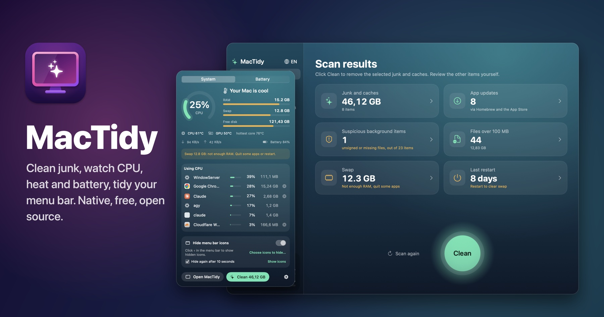
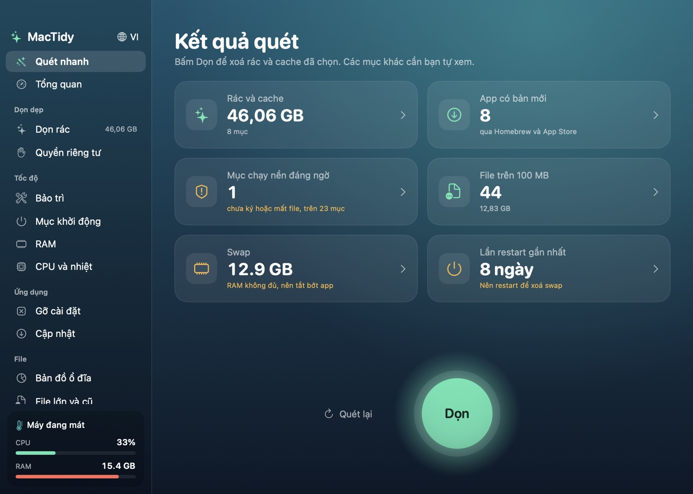
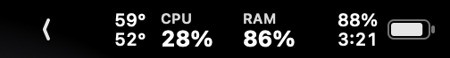
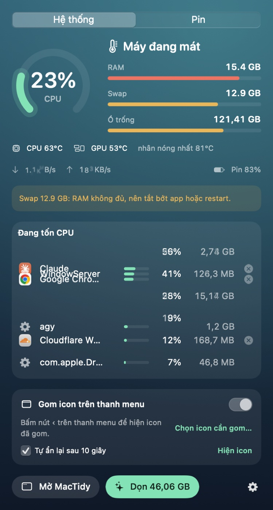

<p align="center">
  
</p>

<p align="center">
  <a href="https://github.com/huahuu1/MacTidy/releases/latest"></a>
  
  
  <a href="LICENSE"></a>
</p>

<p align="center">
  <a href="README.md">English</a> · <b>Tiếng Việt</b>
</p>

MacTidy là app macOS viết bằng SwiftUI để dọn rác, xem app nào làm máy chậm hoặc nóng, và hiện CPU, nhiệt độ, pin trên thanh menu. App nặng khoảng 4 MB, chạy nền tốn 1 đến 2% CPU.

## Mục lục

- [Cài đặt](#cài-đặt)
- [Tính năng](#tính-năng)
- [Hướng dẫn sử dụng](#hướng-dẫn-sử-dụng)
- [Hỏi AI trước khi xoá](#hỏi-ai-trước-khi-xoá)
- [Quyền riêng tư và an toàn](#quyền-riêng-tư-và-an-toàn)
- [Tự build từ code](#tự-build-từ-code)
- [Câu hỏi thường gặp](#câu-hỏi-thường-gặp)

## Cài đặt

### Homebrew (nên dùng)

```bash
brew install --cask huahuu1/tap/mactidy
```

Cập nhật bản mới:

```bash
brew upgrade --cask mactidy
```

### File DMG

1. Tải `MacTidy-x.x.dmg` ở trang [Releases](https://github.com/huahuu1/MacTidy/releases/latest).
2. Mở file, kéo **MacTidy** vào **Applications**. Bắt buộc là `/Applications`: trên macOS 27, chỉ app nằm ở đó mới giữ được icon trên thanh menu khi gom icon.
3. App chưa được Apple xác minh (notarize), nên lần mở đầu bị chặn. Chạy lệnh này một lần rồi mở app bình thường:

```bash
xattr -dr com.apple.quarantine /Applications/MacTidy.app
```

Hoặc vào **Cài đặt hệ thống > Quyền riêng tư & Bảo mật**, bấm **Vẫn mở** cạnh dòng MacTidy.

**Yêu cầu:** macOS 14 Sonoma trở lên, chip Apple hoặc Intel. Gom icon thanh menu không để khoảng trống cần macOS 27.

## Tính năng

| | |
|---|---|
| **Quét nhanh** | Một lần quét tìm rác và cache, app có bản mới, mục chạy nền đáng ngờ, file lớn. Chưa xoá gì cho tới khi bạn bấm Dọn. |
| **Dọn rác** | Cache của app, cache tool dev (Docker, Go, uv, npm, Homebrew, Xcode DerivedData, iOS DeviceSupport), log cũ, file cài đặt trong Downloads, file đính kèm Mail, backup iPhone cũ. File được chuyển vào Thùng rác. |
| **Quyền riêng tư** | Lịch sử duyệt web, cookie của trình duyệt Chromium (Chrome, Edge, Brave, Arc, Cốc Cốc...), danh sách mở gần đây của macOS, lịch sử lệnh Terminal. Mặc định không chọn mục nào. |
| **Bảo trì** | Xoá cache DNS, giải phóng bộ nhớ đệm ổ đĩa, dựng lại danh sách "Mở bằng", dọn snapshot Time Machine trên máy, đánh chỉ mục lại Spotlight, xoá cache Quick Look, chạy script bảo trì của macOS. Chỉ hỏi mật khẩu admin một lần. |
| **Mục khởi động** | App tự mở khi đăng nhập và tiến trình chạy nền, có kiểm tra chữ ký. Mục chưa ký hoặc mất file được đưa lên đầu. |
| **RAM, CPU và nhiệt** | App nào tốn RAM, CPU nhiều nhất, gộp theo app. Nhiệt độ CPU, GPU, nhân nóng nhất đọc từ cảm biến SMC. Thoát hoặc buộc thoát ngay trong danh sách. |
| **Gỡ cài đặt** | Gỡ app cùng file sót lại trong `~/Library`, hoặc chỉ xoá dữ liệu để app như mới cài. |
| **Cập nhật** | App cài qua Homebrew và App Store có bản mới. Cập nhật từng app hoặc tất cả. |
| **Bản đồ ổ đĩa, File lớn, File trùng** | Xem thư mục nào chiếm chỗ, tìm file trên 100 MB hoặc lâu không mở, tìm file trùng theo nội dung (SHA-256). |
| **Số liệu trên thanh menu** | Nhiệt độ CPU và GPU, CPU %, RAM %, tốc độ mạng, pin. Chữ được vẽ vector nên rất nét. Bấm vào để mở popup. |
| **Pin** | Mức pin, sức khoẻ, số lần sạc, dung lượng, nhiệt độ, công suất, dòng điện, điện áp, thông tin củ sạc, app tốn điện nhất. |
| **Gom icon thanh menu** | Chọn icon nào được ẩn, bấm một lần để hiện lại. Trên macOS 27 không để lại khoảng trống. |
| **Báo máy nóng** | Thông báo khi macOS bắt đầu giảm tốc CPU, kèm tên app gây nóng. |
| **Hỏi AI** | Mục nào không chắc có nên xoá không thì nhờ Claude Code kiểm tra. Xem [bên dưới](#hỏi-ai-trước-khi-xoá). |
| **Tiếng Việt và tiếng Anh** | Theo ngôn ngữ của macOS, đổi được bất cứ lúc nào bằng nút quả địa cầu. |

## Hướng dẫn sử dụng

### Quét nhanh



1. Mở MacTidy, bấm **Quét**.
2. Xem các ô kết quả. Bấm vào ô để mở trang tương ứng.
3. Bấm **Dọn** để xoá rác và cache đã chọn. Các mục khác chỉ báo cho bạn biết, bạn tự quyết.

### Dọn rác

- Bật hoặc tắt từng mục bằng công tắc. Tổng dung lượng phía trên tự cập nhật.
- Rê chuột vào một mục và bấm **Hỏi AI** nếu không chắc có nên xoá không.
- **Thùng rác** mặc định không chọn, vì dọn Thùng rác là xoá vĩnh viễn.

### Tổng quan, CPU và nhiệt

- **Tổng quan** hiện CPU, RAM, swap, ổ trống, biểu đồ CPU 4 phút gần nhất và việc nên làm (ví dụ "restart để xoá swap").
- **CPU và nhiệt** liệt kê mọi tiến trình, gộp theo app. Bấm ⓧ để thoát app. **Thoát** thì app hỏi lưu file trước. **Buộc thoát** thì tắt ngay, mất phần chưa lưu.

### Bảo trì

Chọn việc cần làm rồi bấm **Chạy**. Việc có dấu 🔒 cần quyền admin, macOS chỉ hỏi mật khẩu một lần cho tất cả.

### Thanh menu

<p>
  
</p>

Từ trái sang phải: nút hiện icon đã gom, nhiệt độ CPU và GPU, CPU %, RAM %, pin % và thời gian còn lại.

<p>
  
</p>

- Bấm vào số liệu để mở popup. Tab **Hệ thống** hiện mức dùng hiện tại. Tab **Pin** hiện sức khoẻ pin và app tốn điện nhất.
- Nút bánh răng góc dưới bên phải dùng để bật/tắt từng cột, bật **Mở cùng máy**, **Báo khi máy nóng**, và đổi ngôn ngữ.
- Bấm nút đỏ đóng cửa sổ chính thì MacTidy ẩn khỏi Dock. Bấm **Mở MacTidy** trong popup để mở lại.

### Gom icon thanh menu

1. Bấm **Chọn icon cần gom…** trong popup, hoặc mở **Gom icon thanh menu** ở thanh bên trái.
2. Cấp quyền **Trợ năng** khi được hỏi (Cài đặt hệ thống > Quyền riêng tư & Bảo mật > Trợ năng). MacTidy cần quyền này để đọc thanh menu.
3. Bật **Gom** cho các app muốn ẩn.
4. Bấm **‹** trên thanh menu để hiện lại. Icon tự ẩn sau 10 giây, hoặc khi bấm **›**.

### Đổi ngôn ngữ

Bấm nút quả địa cầu trên cùng thanh bên trái, hoặc **bánh răng > Ngôn ngữ / Language** trong popup. MacTidy tự mở lại với ngôn ngữ mới.

## Hỏi AI trước khi xoá

Có những thư mục khó đoán, ví dụ 18 GB cache của uv có đang được project nào dùng không. MacTidy có thể hỏi [Claude Code](https://docs.anthropic.com/en/docs/claude-code) cài trên máy bạn.

1. Cài Claude Code và đăng nhập một lần:

   ```bash
   curl -fsSL https://claude.ai/install.sh | bash
   claude
   ```

2. Trong MacTidy, rê chuột vào một mục ở trang **Dọn rác** hoặc **File lớn và cũ**, bấm **Hỏi AI**.
3. MacTidy tự thu thập dữ kiện trước (dung lượng, lần sửa cuối, process nào đang mở file), rồi Claude trả lời **An toàn để xoá**, **Nên xem lại** hoặc **Đang được dùng**, kèm căn cứ và chi phí của lần hỏi.

Claude chỉ được dùng công cụ đọc (Read, Glob, Grep). Claude không chạy lệnh, không sửa hay xoá file. MacTidy không lưu tài khoản hay API key, chi phí tính vào tài khoản Claude Code của bạn.

## Quyền riêng tư và an toàn

- **Không gửi dữ liệu, không cần tài khoản.** MacTidy chỉ kết nối mạng khi kiểm tra bản cập nhật (qua `brew` và `mas`) hoặc khi bạn bấm **Hỏi AI**.
- **Chuyển vào Thùng rác trước.** File bị xoá nằm trong Thùng rác, lấy lại được. Việc duy nhất xoá vĩnh viễn là dọn Thùng rác, mặc định không chọn.
- **Không tự chọn giúp bạn** ở trang Quyền riêng tư, File lớn, File trùng. Ở File trùng, mỗi nhóm luôn giữ lại ít nhất một bản.
- **API riêng của Apple.** Nhiệt độ đọc từ SMC qua IOKit, và gom icon không khoảng trống trên macOS 27 dùng framework riêng `MenuBarClientCore`. macOS bản sau có thể thay đổi, khi đó tính năng liên quan hiện "—" hoặc dùng cách cũ chứ không làm app bị crash.

## Tự build từ code

Cần Xcode 16 trở lên (Swift 5.10+).

```bash
git clone https://github.com/huahuu1/MacTidy.git
cd MacTidy
./build.sh            # build, ký ad-hoc và cài vào /Applications
./package.sh 1.0      # tạo file DMG universal trong dist/
```

Chữ trong code là tiếng Việt, bản tiếng Anh nằm ở `Localization/en.json`. Script `scripts/l10n_check.py` liệt kê câu chưa dịch.

## Câu hỏi thường gặp

**macOS báo "không thể mở" app.**
App chưa được Apple xác minh. Chạy `xattr -dr com.apple.quarantine /Applications/MacTidy.app` một lần, hoặc bấm **Vẫn mở** trong Cài đặt hệ thống > Quyền riêng tư & Bảo mật. Cài qua Homebrew thì không gặp lỗi này.

**Icon trên thanh menu bị ẩn hết, kể cả icon của MacTidy.**
Kiểm tra app có nằm trong `/Applications` không. Trên macOS 27, app ở chỗ khác không nằm trong danh sách được phép.

**Nhiệt độ hiện "—".**
Cảm biến của máy bạn dùng tên khoá MacTidy chưa biết. Bạn mở issue kèm tên dòng máy nhé.

**App có "dọn RAM" không?**
Không. macOS tự quản lý RAM. MacTidy chỉ cho bạn thấy app nào tốn RAM và swap để tắt bớt hoặc restart.

**Gỡ app thế nào?**
Thoát bằng **bánh răng > Thoát MacTidy**, rồi chạy `brew uninstall --zap --cask mactidy`. Hoặc kéo app vào Thùng rác rồi chạy `defaults delete io.github.huahuu1.mactidy`.

## Ghi công

- Cách gom icon không khoảng trống trên macOS 27 học theo [Hidden Bar](https://github.com/dwarvesf/hidden) (MIT).
- Lấy ý tưởng từ CleanMyMac, Stats và Ice. MacTidy là dự án độc lập, không liên quan tới các app đó.

## Giấy phép

[MIT](LICENSE)
